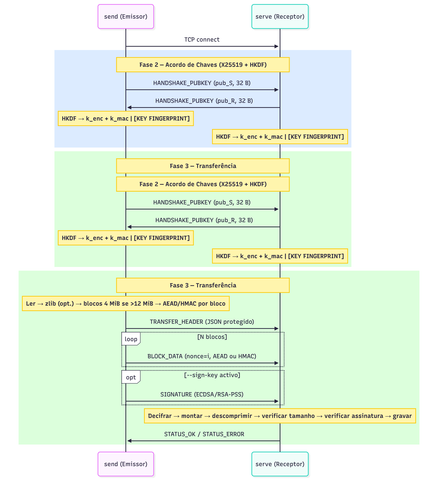
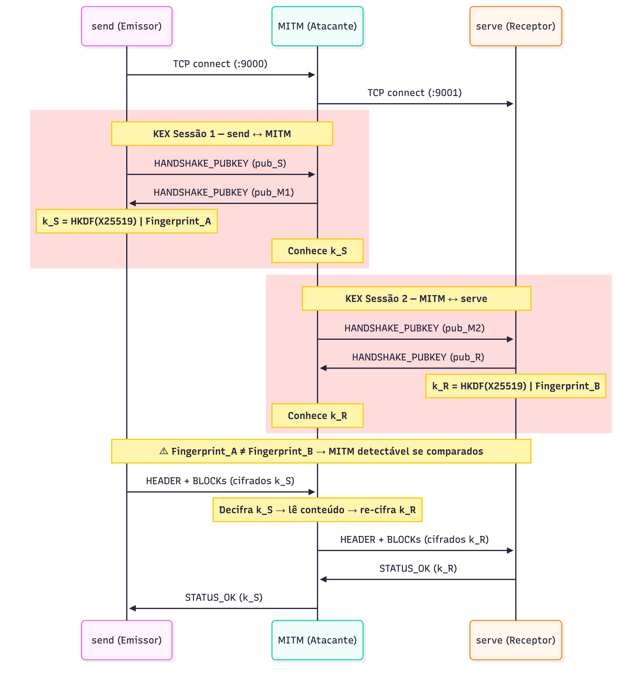

# TWO-HEADED-BEAST

Aplicação Python para transmissão segura de ficheiros via TCP. Um processo fica à escuta (`serve`); o outro conecta e envia (`send`). A sessão é protegida com acordo de chaves **X25519 + HKDF**, integridade por bloco via **AEAD** ou **HMAC**, compressão **zlib** opcional e assinatura digital opcional (**ECDSA** / **RSA-PSS**).

## Contexto

Trabalho da disciplina de **Cibersegurança** — Informática Web, Móvel e na Nuvem, UBI 2025/2026.

O enunciado pede uma aplicação que transmita ficheiros potencialmente grandes de forma segura entre dois utilizadores, com dois processos a correr em simultâneo — um emite, o outro recebe. Os requisitos cobertos:

**Obrigatórios**
- Ficheiros com payload superior a 12 MiB partidos em blocos de 4 MiB, com integridade garantida por bloco.
- Modo sem cifra (`--no-encrypt`) com código de autenticação de mensagem (HMAC) no cabeçalho e em cada bloco.
- Acordo de chaves de sessão com ECDH X25519 e derivação HKDF — a biblioteca `cryptography` usa OpenSSL como backend.
- Compressão do ficheiro antes de cifrar (`--compress`).
- Erros de verificação exibidos em ambos os lados da comunicação.

**Opcionais implementados**
- Assinatura digital (ECDSA P-256/P-384 ou RSA-PSS) e verificação com chave pública PEM ou certificado X.509.
- Escolha de cifra (`--cipher`) e comprimento de chave; escolha de função de hash (`--hash`).
- Help completo (`python -m src --help`) e modo interativo com menus (`python -m src menu`).

## Início rápido

```bash
git clone https://github.com/fefogaca/Ciberseguranca-TG.git
cd Ciberseguranca-TG
python -m venv .venv
source .venv/bin/activate       # Windows: .venv\Scripts\activate
pip install -r requirements.txt
```

> [!NOTE]
> No macOS/Linux, se `python` não for reconhecido ao criar o ambiente virtual, usa `python3 -m venv .venv`. Após a activação do venv, usa sempre `python`.

Terminal 1 — receptor:
```bash
python -m src serve --port 9000 --output-dir ./received
```

Terminal 2 — emissor:
```bash
python -m src send --port 9000 --file ./documento.pdf
```

> [!TIP]
> Para receber de **outra máquina na LAN**, usa `--host 0.0.0.0` no `serve` e aponta o `send` para o IPv4 do receptor. Confirma que a porta TCP escolhida está aberta no firewall.

## Modo interativo

```bash
python -m src menu
```

Assistente passo a passo para enviar e receber, com gestão de destinos guardados em `~/.two-headed-beast/peers.json` (Windows: `C:\Users\<user>\.two-headed-beast\peers.json`).

Material local opcional: algumas equipas mantêm uma pasta **`help/`** (guia de testes de apresentação, script para gerar PDF/amostras) — essa pasta costuma estar no `.gitignore` e **não vem** no `git clone`; gerem-na localmente ou partilhem-na fora do GitHub. O comando típico na raiz do repositório é `python help/scripts/gerar_material_demo.py` (caminhos de exemplo no guia dentro de `help/docs/`).

## Referência de comandos

> [!IMPORTANT]
> Ambos os lados devem usar os mesmos `--cipher`, `--hash`, `--compress` e `--no-encrypt`. Não existe negociação automática de parâmetros — se divergirem, o cabeçalho de transferência não será verificado correctamente. Na receção, a CLI recusa um envio se o emissor e o receptor não acordarem explicitamente em `--compress` (embora o cabeçalho autenticado já indique se os dados foram comprimidos).

### Cifras e hashes

| Cifra (`--cipher`) | Tamanho da chave |
|---|---|
| `AES-128-GCM` | 128 bits |
| `AES-256-GCM` *(padrão)* | 256 bits |
| `CHACHA20-POLY1305` | 256 bits |

Hashes (`--hash`): `SHA256` *(padrão)*, `SHA384`, `SHA512`.

### Exemplos

**Com compressão:**
```bash
python -m src serve --port 9000 --output-dir ./received --compress
python -m src send  --port 9000 --file ./grande.bin --compress
```

**Sem cifra (apenas HMAC):**
```bash
python -m src serve --port 9000 --output-dir ./received --no-encrypt
python -m src send  --port 9000 --file ./dados.bin --no-encrypt
```

**Assinatura digital** — gerar par de chaves com OpenSSL e usá-las:
```bash
openssl ecparam -name prime256v1 -genkey -noout -out private.pem
openssl ec -in private.pem -pubout -out public.pem

python -m src serve --port 9000 --output-dir ./received --verify-key public.pem
python -m src send  --port 9000 --file ./relatorio.pdf --sign-key private.pem
```

**Uma só receção e terminar:**
```bash
python -m src serve --port 9000 --output-dir ./received --once
```

**Ajuda completa:**
```bash
python -m src --help
```

## Arquitectura do sistema



O protocolo corre em três fases: **ligação TCP → acordo de chaves X25519 (KEX) → transferência de dados com STATUS final**. O emissor comprime opcionalmente, parte em blocos se o payload exceder 12 MiB, protege cada bloco com AEAD ou HMAC e envia. O receptor verifica bloco a bloco, remonta, descomprime e confirma o tamanho original antes de gravar.

## Modelo de ameaça

> [!NOTE]
> O enunciado pede explicitamente que se identifique uma forma de atacar o sistema e se apresente na defesa do trabalho.



O ataque demonstrado é o **MITM no acordo ECDH não autenticado**: as chaves X25519 são efémeras mas sem vinculação de identidade, pelo que um intermediário pode negociar sessões separadas com cada lado sem que a transferência falhe.

> [!WARNING]
> Após o KEX, cada terminal imprime uma linha **[IMPRESSÃO DIGITAL DA CHAVE]**. Se os valores nos dois lados divergirem, existe intermediário. O modo interativo permite persistir e comparar impressões digitais entre sessões via `peers.json`.

## Estrutura do código

| Módulo | Responsabilidade |
|---|---|
| `cli.py` | Parsing de argumentos, subcomandos `serve` / `send` / `menu` |
| `kex.py` | Acordo X25519, derivação HKDF, impressão digital TOFU |
| `transfer.py` | Pipeline: compressão → blocos → cifra/MAC → envio/receção |
| `protocol.py` | Framing TCP (4 bytes comprimento + 1 byte tipo + payload) |
| `signature.py` | Assinatura ECDSA/RSA-PSS e verificação com chave pública ou X.509 |
| `crypto_config.py` | Catálogo de cifras e hashes; mapeamentos centralizados |
| `interactive.py` | Menus guiados, gestão de peers |
| `peers.py` | Persistência de destinos e impressões digitais TOFU |
| `branding.py` | Identidade visual no terminal (ANSI) |

## Autores

[Afonso Esteves](https://github.com/flateri) · Felipe Dourado · [João Vitor Silva](https://github.com/joaovitor-o-ss) · [Rui Machado](https://github.com/ruimachado-ai) · [Tiago Pereira](https://github.com/tiagopereira001)  
UBI — Universidade da Beira Interior, Cibersegurança 2025/2026
