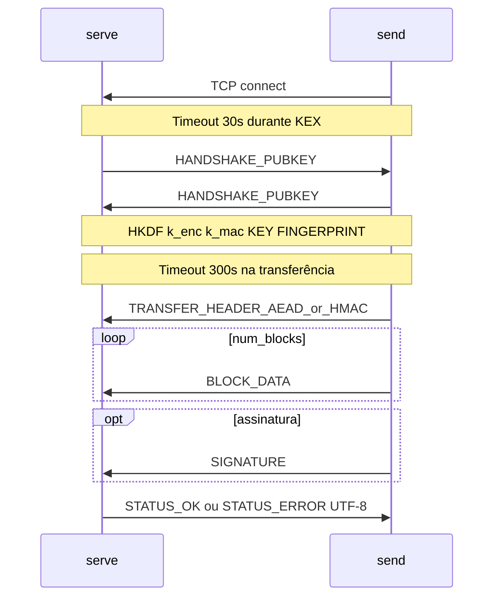

# TWO-HEADED-BEAST

Aplicação de linha de comandos em **Python 3** para transferir ficheiros entre dois processos via **TCP**, com acordo de chaves **X25519**, derivação **HKDF**, integridade por bloco (**AEAD** ou **HMAC**), compressão **zlib** opcional e assinatura digital opcional (**ECDSA** ou **RSA-PSS**). A biblioteca [`cryptography`](https://cryptography.io/) utiliza **OpenSSL** por baixo, alinhando o projeto ao enunciado da unidade curricular.

## Instalação

Recomenda-se um ambiente virtual:

```bash
python3 -m venv .venv
source .venv/bin/activate   # Linux/macOS
pip install -r requirements.txt
```

## Uso rápido

**Requisito:** o **servidor** (`serve`) e o **cliente** (`send`) devem ser arrancados com os **mesmos** parâmetros `--cipher`, `--hash`, `--compress` e `--no-encrypt`. Não há negociação dinâmica; se divergirem, a decifragem ou verificação do **cabeçalho de transferência** falha.

### Modo interativo (menus)

Para guiar o envio/receção sem memorizar flags, com ecrãs e destinos guardados:

```bash
python -m thb menu
```

- Splash UBI / autores na entrada; submenus usam cabeçalho compacto.
- Os assistentes mostram **dicas** para IP/porta/caminhos; valores entre `()` não se duplicam em `[…]`. Em **Receber**, Enter na primeira pergunta usa **0.0.0.0** e **9000** (definir manual só se responder «sim»).
- Destinos (IP + alias + porta) ficam em `~/.thb/peers.json` (Windows: `C:\Users\…\.thb\peers.json`).
- Os comandos `serve` e `send` abaixo mantêm-se para utilizadores avançados.

Se correres só `python -m thb` sem subcomando, aparece o splash e um resumo de uso.

### Dois terminais (exemplo mínimo)

```bash
# Terminal 1 — receptor
python -m thb serve --host 127.0.0.1 --port 9000 --output-dir ./received

# Terminal 2 — emissor
python -m thb send --host 127.0.0.1 --port 9000 --file ./meuficheiro.pdf
```

### Servidor persistente (várias receções)

Por defeito o `serve` **fica à escuta** após cada ficheiro: cada nova ligação faz um **novo acordo X25519** e novas chaves (sessões independentes). Interrompe com **Ctrl+C**.

```bash
python -m thb serve --host 0.0.0.0 --port 9000 --output-dir ./received
# recebe ficheiro 1… depois 2… Ctrl+C para parar
```

Comportamento **antigo** (uma receção e o processo termina):

```bash
python -m thb serve --host 127.0.0.1 --port 9000 --output-dir ./received --once
```

Use `--quiet` / `-q` em `serve` ou `send` para omitir a linha de créditos no arranque (útil em scripts).

### Compressão e ChaCha20-Poly1305

```bash
python -m thb serve --port 9000 --output-dir ./recv --compress --cipher CHACHA20-POLY1305
python -m thb send --port 9000 --file ./grande.bin --compress --cipher CHACHA20-POLY1305
```

### Apenas autenticação (sem cifra, HMAC por bloco)

Não utilize `--cipher` juntamente com `--no-encrypt`.

```bash
python -m thb serve --port 9000 --output-dir ./recv --no-encrypt
python -m thb send --port 9000 --file ./dados.bin --no-encrypt
```

### Assinatura digital (ECDSA ou RSA)

```bash
# Gerar par de chaves ECDSA P-256 (exemplo com OpenSSL)
openssl ecparam -name prime256v1 -genkey -noout -out private.pem
openssl ec -in private.pem -pubout -out public.pem

python -m thb serve --port 9000 --output-dir ./recv --verify-key public.pem
python -m thb send --port 9000 --file ./relatorio.pdf --sign-key private.pem
```

O campo `sign_algo` no cabeçalho é **inferido** da chave privada (`ECDSA-P256`, `ECDSA-P384`, `RSA-PSS`). A verificação falha se a chave pública (ou certificado X.509) não for compatível com esse algoritmo.

### Ficheiro de teste grande (> 12 MiB após compressão)

```bash
dd if=/dev/urandom of=testfile.bin bs=1M count=20
python -m thb serve --port 9000 --output-dir ./recv --compress
python -m thb send --port 9000 --file ./testfile.bin --compress
```

## Diagrama do protocolo (sequência)



## Cifras e hashes suportados

| Cifra (AEAD)      | Tamanho da chave |
|-------------------|------------------|
| AES-128-GCM       | 128 bits         |
| AES-256-GCM       | 256 bits         |
| CHACHA20-POLY1305 | 256 bits         |

**Hashes** (HKDF, HMAC, assinatura): `SHA256`, `SHA384`, `SHA512`.

## Vetores de ataque e mitigações (para apresentação)

| Ameaça | Discussão |
|--------|-----------|
| **MITM no ECDH** | Sem autenticação das chaves públicas efémeras, um atacante pode negociar segredos diferentes com cada extremo. **Mitigação parcial:** comparar o **[KEY FINGERPRINT]** (TOFU). |
| **Alteração do cabeçalho** | O JSON de metadados é o primeiro conteúdo protegido com **AEAD (nonce 0)** ou **HMAC** após o KEX. |
| **Reutilização de nonce em GCM** | **Nonces determinísticos:** 12 bytes big-endian, **0** para o cabeçalho e **1…N** para cada bloco de dados. |
| **Truncagem** | O receptor verifica **num_blocks** e **original_size** após descompressão. |
| **Downgrade de algoritmo** | Os algoritmos são escolhidos localmente; o cabeçalho autenticado regista o que o emissor usou; parâmetros **têm** de ser iguais nos dois lados para o KEX bater certo. |

## Limitações (prototipagem)

- O socket de escuta usa `listen(1)`; o servidor pode atender **várias sessões em sequência** (cada uma termina e volta a `accept`), exceto com `--once`.
- **Salt fixo** na HKDF (`thb-v1-salt`); não é negociado.
- **Forward secrecy** apenas *entre sessões* no sentido de novo X25519 por ligação; o desenho global não é estilo “Signal”.
- Compressão apenas **zlib**.
- **Timeouts:** 30 s durante o KEX e 300 s após, em **ambos** os lados (`socket.settimeout`).
- Estados de erro remoto são enviados como **UTF-8** em `STATUS_ERROR` (sem JSON).

## Estrutura do pacote

- `thb/cli.py` — argparse, `serve` / `send` / `menu`, `--quiet`, `--once` no servidor
- `thb/interactive.py` — menus e construção de argumentos para reutilizar a lógica do CLI
- `thb/branding.py` — splash UBI, cabeçalho compacto, cores ANSI
- `thb/peers.py` — `~/.thb/peers.json` (alias, host, porta)
- `thb/protocol.py` — framing 4 bytes + tipo + payload
- `thb/kex.py` — X25519, HKDF, fingerprint
- `thb/transfer.py` — compressão, partição >12 MiB (blocos de 4 MiB), envio/receção
- `thb/signature.py` — assinatura e verificação
- `thb/crypto_config.py` — listas fechadas e validação

## Licença e contexto

Projeto académico — Cibersegurança (UBI). Ver enunciado do trabalho TWO-HEADED-BEAST no material da disciplina.
