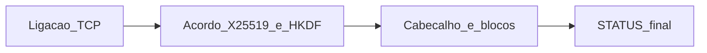
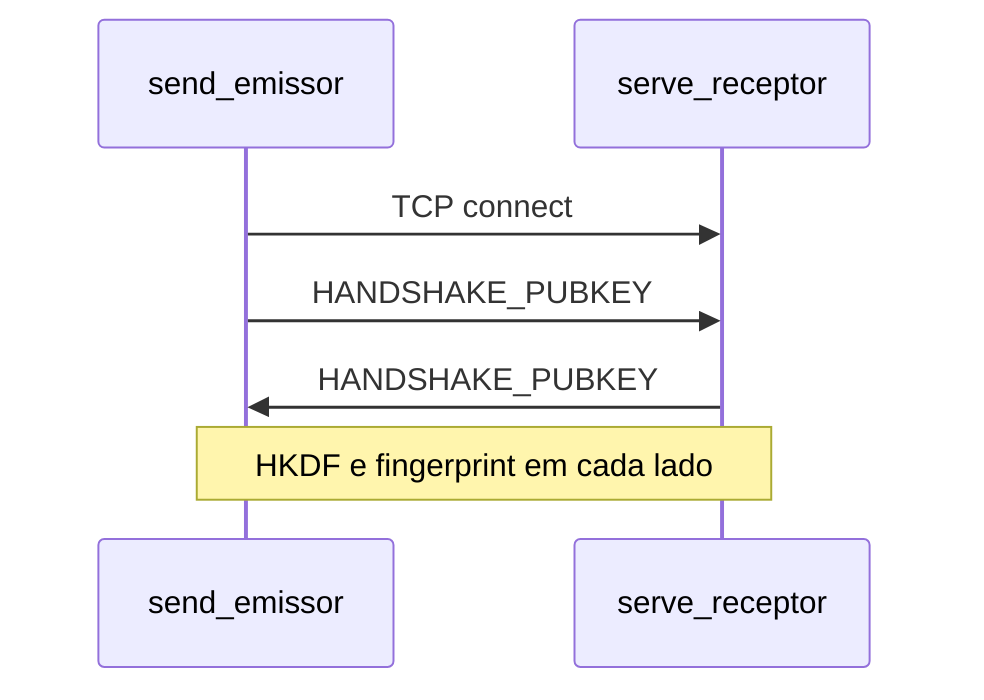
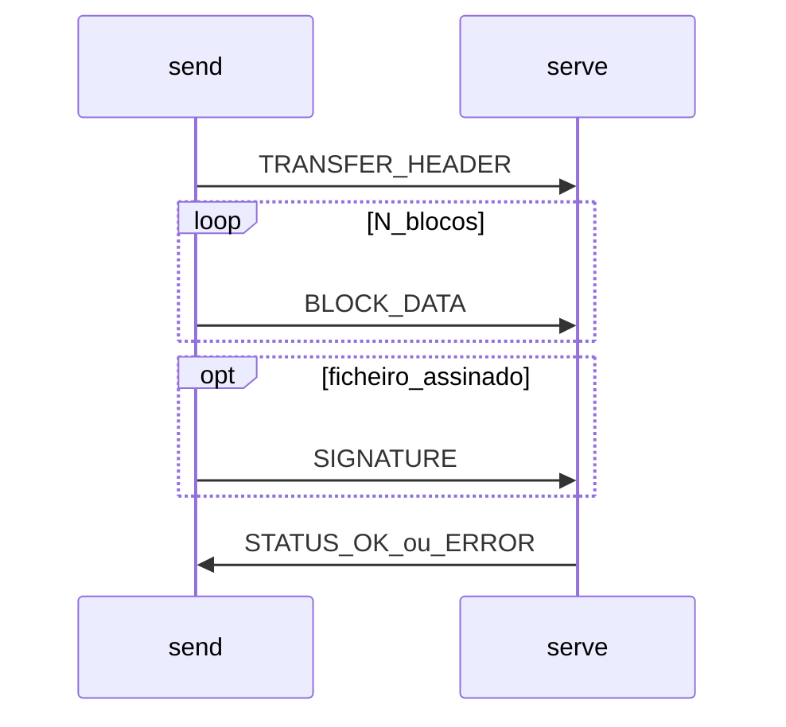

# TWO-HEADED-BEAST


Aplicação em **Python 3**: o código do pacote está em **[`src/`](src/)** na raiz do repositório; arranque com **`python -m src`** a partir dessa raiz (onde está `requirements.txt`). Transmissão **TCP** com acordo **X25519** (ECDH), derivação **HKDF**, integridade por bloco (**AEAD** ou **HMAC**), **zlib** opcional e assinatura opcional (**ECDSA** / **RSA-PSS**). A biblioteca [`cryptography`](https://cryptography.io/) usa tipicamente **OpenSSL** como backend (o handshake no código é X25519 + HKDF, sem invocar o executável `openssl` para o KEX).

## Obter o código

Clona o repositório no GitHub e entra na pasta do projeto (o nome da pasta depende do remoto):

```bash
git clone https://github.com/fefogaca/Ciberseguranca-TG.git
cd Ciberseguranca-TG
```

## Índice

- [Obter o código](#obter-o-código)
- [Diagramas](#diagramas)
- [Requisitos](#requisitos)
- [Instalação](#instalação)
  - [Windows](#windows)
  - [macOS e Linux](#macos-e-linux)
- [Primeiro teste (dois terminais na mesma máquina)](#primeiro-teste-dois-terminais-na-mesma-máquina)
- [Rede local: duas máquinas](#rede-local-duas-máquinas)
  - [Cenário A (Windows recebe, Mac envia)](#cenário-a-windows-recebe-mac-envia)
  - [Cenário B (Mac recebe, Windows envia)](#cenário-b-mac-recebe-windows-envia)
- [Modo interativo (menu)](#modo-interativo-menu)
- [Linha de comando avançada](#linha-de-comando-avançada)
- [O protocolo em camadas](#o-protocolo-em-camadas)
- [Cifras e hashes](#cifras-e-hashes)
- [Ficheiros grandes e partição em blocos](#ficheiros-grandes-e-partição-em-blocos)
- [KEX, OpenSSL e enunciado académico](#kex-openssl-e-enunciado-académico)
- [Vetores de ataque e mitigações](#vetores-de-ataque-e-mitigações)
- [Limitações](#limitações)
- [Resolução de problemas](#resolução-de-problemas)
- [Estrutura do pacote `src/`](#estrutura-do-pacote-src)
- [Contexto académico](#contexto-académico)

## Diagramas

Figuras de apoio ao relatório e à apresentação do TWO-HEADED-BEAST.

### Arquitectura do sistema


### Cenário de ataque (modelo de ameaça)


## Requisitos

- **Python 3** nas máquinas que correm `serve` / `send`.
- O mesmo código do projeto (Git, pasta partilhada, etc.).
- Para testes entre PCs: **mesma rede local** (mesmo Wi‑Fi ou Ethernet ao mesmo router), salvo túneis/VPN que expõem TCP.

**Regra crítica:** em cada transferência, `serve` e `send` devem usar os **mesmos** `--cipher`, `--hash`, `--compress` e `--no-encrypt`. Não há negociação no protocolo.

## Instalação

Na **raiz do repositório** (pasta que contém `requirements.txt` e a pasta `src/`), onde vais correr `python -m src`:

### Windows

No **PowerShell** ou **CMD**:

```powershell
cd "C:\caminho\para\o-repositorio-clonado"
python -m venv .venv
.\.venv\Scripts\activate
pip install -r requirements.txt
```

Se `python` não for reconhecido, experimenta o launcher:

```powershell
py -m venv .venv
.\.venv\Scripts\activate
py -m pip install -r requirements.txt
```

### macOS e Linux

```bash
cd ~/caminho/para/o-repositorio-clonado
python3 -m venv .venv
source .venv/bin/activate
pip install -r requirements.txt
```

## Primeiro teste (dois terminais na mesma máquina)

Terminal 1 (receptor):

```bash
python -m src serve --host 127.0.0.1 --port 9000 --output-dir ./received
```

No Windows podes usar `.\received` em alternativa a `./received`.

Terminal 2 (emissor):

```bash
python -m src send --host 127.0.0.1 --port 9000 --file ./meuficheiro.pdf
```

## Rede local: duas máquinas

> **Nota:** o processo que **recebe** (`serve`) deve usar `--host 0.0.0.0` para aceitar ligações **de outras máquinas** na LAN, e a **porta TCP** (ex.: 9000) deve estar permitida no **firewall** do sistema receptor.

### Cenário A: Windows recebe, Mac envia

**Pré-requisitos comuns:** mesmo projeto nas duas máquinas; Python 3; mesmos flags criptográficos nos exemplos abaixo (omissões: AES-256-GCM, SHA256, sem `--compress`).

#### A1. Windows — preparação

1. Instalar Python a partir de [python.org/downloads/windows](https://www.python.org/downloads/windows/) (opção **Add python.exe to PATH** quando existir).
2. Na pasta do projeto, criar venv e dependências (ver [Windows](#windows)).
3. **Firewall — regra de entrada TCP** (exemplo para porta **9000**):
   1. Painel de controlo → Firewall do Windows → Definições avançadas.
   2. Regras de entrada → Nova regra → **Porta** → **TCP** → portas locais **9000**.
   3. **Permitir a ligação**; perfis: pelo menos **Privado**; nome: ex. `Transferência TCP 9000`.
4. Descobrir o **IPv4** da máquina Windows: no PowerShell, `ipconfig` — anotar o endereço da interface em uso (Wi‑Fi ou Ethernet), por exemplo `192.168.1.45`.

#### A2. Windows — iniciar o servidor

```powershell
python -m src serve --host 0.0.0.0 --port 9000 --output-dir .\received
```

Manter o terminal aberto. O ficheiro recebido aparece em `received\` com o **mesmo nome** base que o enviado.

#### A3. Mac — enviar

```bash
cd ~/caminho/para/o-repositorio-clonado
source .venv/bin/activate
python -m src send --host 192.168.1.45 --port 9000 --file "$HOME/Imagens/foto.png"
```

(Substituir o IP pelo IPv4 do Windows e o caminho pelo ficheiro real.)

### Cenário B: Mac recebe, Windows envia

1. No **Mac**, descobre o IPv4 (Definições de rede ou `ifconfig` / `ip link` em Linux puro).
2. No Mac, corre `serve` com `--host 0.0.0.0` e a pasta de saída desejada.
3. Se o **firewall do macOS** bloquear entradas, permite Python ou a porta em **Definições → Rede → Firewall** (conforme versão do sistema).
4. No **Windows**, corre `send` com `--host <IPv4_do_Mac>` e caminho `C:\...\ficheiro.ext`.

Os mesmos avisos sobre **parâmetros iguais** e **porta aberta** aplicam-se; só trocam os papéis das máquinas.

### Exemplos na LAN (compressão / outra cifra / assinatura)

**Compressão** — os **dois** lados com `--compress`:

```powershell
python -m src serve --host 0.0.0.0 --port 9000 --output-dir .\received --compress
```

```bash
python -m src send --host 192.168.x.x --port 9000 --file "/caminho/imagem.png" --compress
```

**ChaCha20-Poly1305** — mesmos flags nos dois:

```powershell
python -m src serve --host 0.0.0.0 --port 9000 --output-dir .\received --cipher CHACHA20-POLY1305
```

```bash
python -m src send --host 192.168.x.x --port 9000 --file "/caminho/imagem.png" --cipher CHACHA20-POLY1305
```

**Assinatura** (gerar PEM com OpenSSL; copiar chaves para ambas as máquinas):

```powershell
python -m src serve --host 0.0.0.0 --port 9000 --output-dir .\received --verify-key C:\caminho\public.pem
```

```bash
python -m src send --host 192.168.x.x --port 9000 --file "/caminho/imagem.png" --sign-key /caminho/private.pem
```

> **Tipos de ficheiro:** qualquer ficheiro em modo binário (imagens, PDF, ZIP, etc.).

## Modo interativo (menu)

```bash
python -m src menu
```

Assistentes para enviar/receber, gestão de destinos guardados em:

| Sistema   | Ficheiro de peers |
|-----------|-------------------|
| Unix      | `~/.two-headed-beast/peers.json` |
| Windows   | `C:\Users\<utilizador>\.two-headed-beast\peers.json` |

Ao **enviar** para um endereço novo no assistente, guarde primeiro o **destino** (alias) e **depois** o opt-in do [KEY FINGERPRINT] (TOFU), para o `fingerprint` ficar na mesma entrada em `peers.json`. Ao **receber** em modo contínuo (várias sessões), o programa só conhece o fingerprint da **última** sessão antes de interromper com Ctrl+C.

Sem subcomando, `python -m src` mostra o splash e um resumo de uso.

## Linha de comando avançada

### Servidor persistente vs uma sessão

Por defeito o `serve` continua à escuta; cada ligação faz **novo** X25519. **Ctrl+C** para parar.

```bash
python -m src serve --host 0.0.0.0 --port 9000 --output-dir ./received
```

Uma só receção e terminar:

```bash
python -m src serve --host 127.0.0.1 --port 9000 --output-dir ./received --once
```

### Compressão e ChaCha20-Poly1305

```bash
python -m src serve --port 9000 --output-dir ./recv --compress --cipher CHACHA20-POLY1305
python -m src send --port 9000 --file ./grande.bin --compress --cipher CHACHA20-POLY1305
```

### Apenas autenticação (sem cifra, HMAC por bloco)

Não passes `--cipher` manualmente em conjunto com **`--no-encrypt`** (o programa valida a combinação).

```bash
python -m src serve --port 9000 --output-dir ./recv --no-encrypt
python -m src send --port 9000 --file ./dados.bin --no-encrypt
```

### Assinatura digital

```bash
openssl ecparam -name prime256v1 -genkey -noout -out private.pem
openssl ec -in private.pem -pubout -out public.pem

python -m src serve --port 9000 --output-dir ./recv --verify-key public.pem
python -m src send --port 9000 --file ./relatorio.pdf --sign-key private.pem
```

### Ficheiro grande para testar blocos

```bash
dd if=/dev/urandom of=testfile.bin bs=1M count=20
python -m src serve --port 9000 --output-dir ./recv --compress
python -m src send --port 9000 --file ./testfile.bin --compress
```

### Saída silenciosa

`--quiet` / `-q` omite a linha de créditos no arranque de `serve` / `send`.

## O protocolo em camadas

### Visão geral (três fases)



### Fase 2 — troca de chaves públicas (ordem real do código)

No **`serve`** (receptor): primeiro **recebe** `HANDSHAKE_PUBKEY` (32 bytes), depois **envia** a sua chave pública. No **`send`** (emissor): primeiro **envia**, depois **recebe**. Segue-se derivação **HKDF** → `k_enc` (ou omitida se `--no-encrypt`) e `k_mac` (32 bytes), e impressão do **[KEY FINGERPRINT]** para verificação TOFU.

**Timeouts (socket):** ~**30 s** durante o handshake; após sucesso, ~**300 s** durante a transferência (configurado em `src/cli.py` nos dois lados).



### Fase 3 — dados e fim da sessão

Passos lógicos (espelha `src/transfer.py`):

1. **TRANSFER_HEADER** — metadados JSON (nome, tamanhos, blocos, algoritmos) protegidos com **AEAD** (nonce fixo para o header) ou **HMAC** se não houver cifra.
2. **BLOCK_DATA** — repetido **N** vezes; cada bloco é **cifrado com AEAD** ou **autenticado com HMAC** (contador + dados).
3. Opcionalmente **SIGNATURE** sobre o conteúdo original.
4. **STATUS_OK** ou **STATUS_ERROR** (UTF-8 no erro).



### Tipos de mensagem (`src/protocol.py`)

| Byte | Constante       | Função resumida |
|------|-----------------|-----------------|
| `0x01` | `HANDSHAKE_PUBKEY` | Chave pública X25519 raw (32 B) |
| `0x02` | `TRANSFER_HEADER` | Cabeçalho JSON cifrado ou com MAC |
| `0x03` | `BLOCK_DATA`      | Bloco de payload |
| `0x04` | `SIGNATURE`       | Assinatura digital (opcional) |
| `0x10` | `STATUS_OK`       | Sucesso |
| `0x11` | `STATUS_ERROR`    | Erro (mensagem UTF-8) |

## Cifras e hashes

| Cifra (AEAD)      | Tamanho da chave |
|-------------------|------------------|
| AES-128-GCM       | 128 bits         |
| AES-256-GCM       | 256 bits         |
| CHACHA20-POLY1305 | 256 bits         |

**Hashes** (HKDF, HMAC, assinatura): `SHA256`, `SHA384`, `SHA512`.

## Ficheiros grandes e partição em blocos

- Se o tamanho do payload **após compressão opcional** (`zlib`) for **superior a 12 MiB**, os dados são partidos em blocos de **4 MiB**; cada bloco é tratado como mensagem **BLOCK_DATA** com integridade própria (AEAD ou HMAC).
- Se o payload comprimido for **≤ 12 MiB**, há um único bloco com o tamanho total.

> **Decisão de implementação (12 MiB):** a **partição em blocos** de 4 MiB activa-se quando o **payload após compressão opcional** (`zlib`) é **superior a 12 MiB**, não quando o ficheiro original em disco excede esse valor. Ou seja, um ficheiro grande pode **não** ser partido se comprimir abaixo do limiar; um ficheiro mais pequeno pode ser partido se compressão estiver desactivada e o payload raw for grande. Isto está alinhado com a definição “tamanho efectivo a transmitir”. Se o enunciado exigir explicitamente o **tamanho pré-compressão**, é necessário alterar `src/transfer.py` (`send_file`) para calcular `num_blocks` / `block_size` a partir de `len(original_data)`.

## KEX, OpenSSL e enunciado académico

- O programa implementa **ECDH** com **Curve25519** (`X25519`) e deriva chaves com **HKDF** (`src/kex.py`). Isto cumpre o espírito de “acordo Diffie–Hellman / chave pública” em contexto moderno.
- **OpenSSL:** o projeto usa **cryptography** (com backend OpenSSL comum em macOS/Linux/Windows). O **executável** `openssl` pode ser usado para **gerar par de chaves** de assinatura (exemplos acima); o **handshake** deste programa não chama `openssl` como subprocesso.
- Se o docente exigir **DH clássico** (grupo finito) ou **obrigatoriedade** de `openssl` no KEX, isso seria uma extensão em relação ao código actual.

## Vetores de ataque e mitigações

| Ameaça | Discussão |
|--------|-----------|
| **MITM no ECDH** | Chaves efémeras sem PKI: atacante pode fazer KEX diferentes com cada lado. **Mitigação parcial:** comparar **[KEY FINGERPRINT]** (TOFU). |
| **Alteração do cabeçalho** | JSON protegido com **AEAD** (nonce dedicado) ou **HMAC** após o KEX. |
| **Nonce em GCM** | Nonces explícitos: zero dedicado ao header; **1…N** por bloco de dados. |
| **Truncagem** | Verificação de `num_blocks` e `original_size` após descompressão. |
| **Downgrade** | Parâmetros fixos por CLI; cabeçalho autenticado descreve o que o emissor usou; **os dois lados têm de coincidir** ou a verificação falha. |

## Limitações

- `listen(1)` no servidor; várias sessões **em sequência** após cada `accept`, exceto com `--once`.
- **Salt fixo** no HKDF (`thb-v1-salt`).
- **Forward secrecy** por sessão (novo X25519 por ligação), não protocolo estilo Signal.
- Compressão apenas **zlib**.
- Erros remotos em `STATUS_ERROR` como texto UTF-8 (sem JSON estruturado).

## Resolução de problemas

| Problema | O que verificar |
|----------|-----------------|
| Timeout ou «Connection refused» | Receptor com `serve` a correr; `--host 0.0.0.0` na LAN; firewall com a porta correta; IPv4 certo. |
| «Failed to decrypt/verify transfer header» / mismatch | **Mesmos** `--cipher`, `--hash`, `--compress`, `--no-encrypt` nos dois processos. |
| IPv4 errado | No Windows: `ipconfig`; no Mac/Linux: definições de rede ou `ifconfig`/`ip`. |
| Porta ocupada | Escolher outra `--port` em **ambos** e abrir essa porta no firewall. |
| Conteúdo corrompido ou HMAC inválido | Algoritmos ou ficheiro errado; verificar compressão e cifra iguais nas duas pontas. |

## Estrutura do pacote `src/`

| Módulo | Conteúdo principal |
|--------|---------------------|
| `cli.py` | `argparse`, `serve` / `send` / `menu`, `--quiet`, `--once` |
| `interactive.py` | Menus e reutilização da validação do CLI |
| `branding.py` | Splash, cabeçalho, cores ANSI |
| `peers.py` | `~/.two-headed-beast/peers.json` |
| `protocol.py` | Framing: 4 bytes comprimento + tipo + payload |
| `kex.py` | X25519, HKDF, fingerprint |
| `transfer.py` | Compressão, blocos >12 MiB, envio/receção |
| `signature.py` | Assinatura e verificação |
| `crypto_config.py` | Listas fechadas e validação |

## Contexto académico

Projeto da disciplina de **Cibersegurança** (Licenciatura em Informática Web, Móvel e na Nuvem — UBI, 2025/2026).

O texto integral do enunciado encontra-se em **[`Enunciado.md`](Enunciado.md)**.

### Requisitos do enunciado (TWO-HEADED-BEAST)

**Obrigatórios:**

- Ficheiros maiores que 12 MB repartidos em blocos, com **integridade por bloco** garantida pelo programa.
- Modo sem cifra: **autenticação da mensagem (MAC)** no cabeçalho e em cada bloco.
- Troca de chaves de sessão via **Diffie–Hellman** ou **criptografia de chave pública** (com possibilidade de recorrer ao OpenSSL).
- Opção de **comprimir** o ficheiro **antes** de cifrar.
- Perante falha de verificação de integridade ou processamento incorrecto, deve ser exibido um **erro em ambos os lados** da comunicação.

**Opcionais implementados:**

- Assinatura digital com chave privada (**ECDSA** P-256/P-384 ou **RSA-PSS**), podendo usar OpenSSL para gerar as chaves.
- Verificação da assinatura com chave pública PEM ou certificado **X.509**.
- Escolha da cifra (`AES-128-GCM`, `AES-256-GCM`, `CHACHA20-POLY1305`) e do comprimento da chave.
- Escolha da função de hash (`SHA256`, `SHA384`, `SHA512`).
- **Help** completo com exemplos (`python -m src --help`).

### Modelo de ameaça trabalhado na apresentação

**MITM** no acordo ECDH não autenticado — ver [Vetores de ataque e mitigações](#vetores-de-ataque-e-mitigações) e o diagrama em [`images/diagrama-do-ataque.png`](images/diagrama-do-ataque.png).

### Autores

[Afonso Esteves](https://github.com/flateri) 55047 · Felipe Dourado 53394 · [João Vitor Silva](https://github.com/joaovitor-oss) 53396 · [Rui Machado](https://github.com/ruimachado-ai) 53867 · [Tiago Pereira](https://github.com/tiagopereira001) 55019
